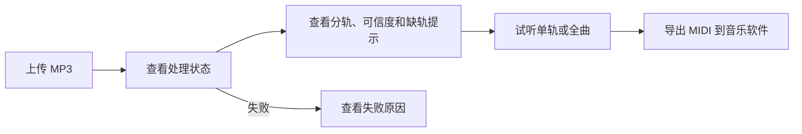
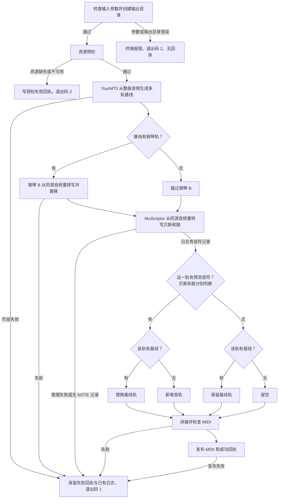

# Noto 产品需求文档（PRD）

## 0. 文档信息

| 项目 | 内容 |
|---|---|
| 版本 | 2.4（存在判断评测） |
| 日期 | 2026-11-26 |
| 阶段 | 【实测 2026-11-25】本地研究原型，一键三轨已实现，端到端质量未验收 |
| 仓库 | [Max-Ren0/audio-to-midi-mvp](https://github.com/Max-Ren0/audio-to-midi-mvp)（公开，`main`） |

| 证据标记 | 说明 |
|---|---|
| 【实测】 | 运行、评测或实现记录，日期为实验或记录日 |
| 【调研】 | 公开资料或项目记录，日期为查阅或记录日 |
| 【假设】 | 待验证的需求或产品判断，日期为提出日 |
| 【计划】 | 待执行的工作，日期为记录日 |

## 1. 需求分析

核心问题：需求真的存在吗？

### 1.1 用户反馈

【调研 2026-11-25】暂无系统化用户反馈。【计划 2026-11-25】记录最近一次扒谱的乐器、工具、卡点、耗时、可用标准及付费或放弃原因。

### 1.2 竞品分析

| 产品与来源 | 人（用途推断） | 事（核心流程） | 钱（收费） | 墙（限制或壁垒） |
|---|---|---|---|---|
| Audio Jam · 【调研 2026-11-24】A1–A5 | 练琴、翻弹、排练者 | 导入音频 → 分轨 → 独奏、变速或循环跟练 | 免费下载＋Pro；美区周 US$6.99、月 US$12.99，年付有 US$29.99 和 US$39.99 条目 | 官方资料未见从音频生成多轨 MIDI |
| 灵谱 · 【调研 2026-11-24】L1–L2 | 扒谱、翻弹、改谱者 | 搜歌、贴链接或导入文件 → 网页看谱、改音 → 分轨导出 MIDI | 按时长充值，新用户赠 10 分钟；价格待补 | 广场成品可能人工编辑过，首稿质量待测 |
| RipX · 【调研 2026-11-24】R1–R5 | 制作、混音、改编用户 | 导入 → 分层 → 逐音修改或归轨 → 选层导出 MIDI | 黑五价 DAW £69／PRO £138（官网标至 2026-12-01），标价 £99／£198 | 专业编辑较完整，样本导出时间原点待核实 |
| NeuralNote v2 · 【调研 2026-11-24】N1–N3 | 使用 DAW（数字音频工作站）的编曲者、乐手 | 本地导入或录入 → 转写并试听 → 保存 MIDI 或拖进 DAW | 软件免费，模型权重限非商用 | 预览后可交 DAW 改音；与 Noto 贝斯、鼓同属 MuScriptor 家族 |
| Moises · 【调研 2026-11-24】M1–M5 | 乐手、学生、教师 | 导入 → 音频分轨 → 混音、循环跟练或导出音频 | 免费／Premium／Pro；美区 Premium US$5.99/月或 US$39.99/年，Pro US$29.99/月 | 分轨输出音频，多轨 MIDI 出口待补 |
| LALAL.AI · 【调研 2026-11-25】[官网功能](https://www.lalal.ai/)／[定价](https://www.lalal.ai/pricing/) | 提取伴奏或声部的乐手、创作者 | 选钢琴、贝斯或鼓 → 上传音视频 → 预览 → 下载 | Starter 免费预览，Lite／Pro 付费下载，FAQ 美元月价 US$9.99／US$19.99 | 输出目标声部及剩余音频；分轨流程未列 MIDI |

【调研 2026-11-25】LALAL.AI、Moises 的分轨流程输出分离音频，Noto 和灵谱输出可编辑音符（MIDI）。其余来源见[竞品对比](competitor-analysis/README.md)。

### 1.3 需求验证

【计划 2026-11-25，未执行】闲鱼搜“扒谱／扒带／MIDI 制作”，记录价格、交期、乐器，观察付费意愿。小红书搜“扒谱 软件／转 MIDI／灵谱”，整理公开抱怨。只看只记，不发帖、不注册。访谈 3–5 人，回顾上次扒谱的过程和卡点。

## 2. 定义问题

核心问题：为谁、在什么时候、解决什么、怎么算解决？

### 2.1 目标用户与场景

【假设 2026-11-25】主用户是想跟流行歌练贝斯、鼓或钢琴的学习者，次要用户是编曲者与创作者。排练前，学习者手里只有歌曲录音，想把可改的声部音符导入音乐软件核对。找不到谱就降速循环、边听边记，卡在听不清的几拍。

【假设 2026-11-25】竞品文档曾优先考虑编曲者。2.0 先做学习者，因为练习乐器与 MVP 三轨一致，扒谱需求也可在闲鱼验证。两类用户的需求待 1.3 验证。【计划 2026-11-25】音乐教师和扒谱人员暂不作为本阶段用户。

【实测 2026-11-06】【计划 2026-11-25】吉他仍是长期目标。《唯一》当前方案的两条吉他轨 F1 均低于 10%，因此 MVP 主用户不纳入吉他爱好者，见 4.3。

### 2.2 痛点与为什么不用竞品

【假设 2026-11-25】**不敢信。** 学贝斯、鼓或钢琴的人拿到自动转出的谱，不知道哪里可能错，只能整首重听核对。

【假设 2026-11-25】**改不动。** 把 MIDI 拖进音乐软件后，音符与小节线对不上，改起来可能比重扒还麻烦。【实测 2026-11-25】Noto 当前也固定写入 120 BPM。

【调研 2026-11-25，待验证对比】仅据公开资料和仓库旧记录。NeuralNote v2 与 Noto 的贝斯、鼓路线同属 MuScriptor。 [竞品对比](competitor-analysis/README.md)

| 竞品 | 给音符吗 | 告诉你哪里可能错吗 | 导出的 MIDI 是否对齐节拍 |
|---|---|---|---|
| 灵谱 | 官网支持多轨 MIDI，旧记录见下载完成 | 未核实 | 未核实。网页有对齐功能 |
| RipX | 支持选层导出 MIDI，仓库解析过多轨样本 | 未核实 | 未核实 |
| NeuralNote | 可按乐器保存 MIDI 或拖进音乐软件 | 未核实 | 未核实 |
| Moises · Audio Jam | 已核实的分轨流程给音频，从录音输出音符未核实 | 未核实 | 未核实 |

| 【计划 2026-11-25，已选定 A+B】方向 | 做法 |
|---|---|
| A · 可信的三轨草稿 | 提供逐轨可信度和缺轨提示，公开评测口径与运行回执，让用户知道哪里可能错 |
| B · 拿来就能编辑 | 检测节拍、对齐小节、映射正确鼓键，拖进音乐软件就能改 |

【计划 2026-11-25】未选方向 C 为节奏组专精（贝斯和鼓）。

### 2.3 问题陈述

【假设 2026-11-25】Noto 为手里只有歌曲混音的贝斯、鼓或钢琴学习者提供可编辑草稿，缩短准备练习的时间。

### 2.4 指标

| 层级 | 指标与状态 |
|---|---|
| 北极星 | 【计划 2026-11-25，未测】真值评测集上的 note-level F1，钢琴、贝斯、鼓分别报告 |
| 后续指标 | 【计划 2026-11-25】人工修改时间需要专家或目标用户，当前无资源。A/B 盲听偏好留待上线后、有资源时补测 |
| 过程 | 【实测 2026-11-25】一键成功 8/8，单段耗时为音频时长的 2.68–10.93 倍；【计划 2026-11-25，未系统测】MIDI 在目标软件中的打开率 |
| 诊断 | 【实测 2026-11-25】逐轨 Precision（P，预测命中率）和 Recall（R，参考音找回率）。F1 按同类、同音高或鼓件、起音误差 ≤50 ms、一对一匹配 |

【调研 2026-11-25】只有以真值 MIDI 计分，F1 才能衡量转写准确度。早期以灵谱生成的 MIDI 为参考，只能衡量与灵谱的一致程度，不能用作真值。

### 2.5 优先级

【计划 2026-11-25】MVP 只验收钢琴、贝斯、鼓。木吉他、清音电吉他、弦乐继续作为研究轨，有音符则输出并报告。当前不做前端。输入可含人声，人声音符不纳入输出及验收目标。

【计划 2026-11-25】当前不承诺还原录音、音色、效果器和力度，任意歌曲的六轨稳定识别，或在线编辑、商业服务。

### 2.6 可行性

| 维度 | 结论 |
|---|---|
| 技术 | 【实测 2026-11-25】本地 MP3 可产出 Type 1 MIDI 与回执，仍有误报和缺轨 |
| 数据 | 【调研 2026-11-25】带可靠逐轨标注的真实多轨录音稀缺，是当前最大瓶颈 |
| 资源 | 【实测 2026-11-25】CPU 单段耗时 2.68–10.93 倍音频时长，钢琴 B 占累计耗时 58.4%。[端到端评测](e2e-eval/README.md#4-成功率与耗时) |
| 合规 | 【调研 2026-11-25】实验用 MuScriptor 权重为 CC BY-NC 4.0，限非商用。【计划 2026-11-25】产品化前确认各模型、权重及依赖许可，以及上传歌曲的存储和结果分享版权。 [权重说明](muscriptor-route/使用说明.md) |

### 2.7 能力边界与上线门槛

【实测 2026-11-25】一键入口与钢琴 B 限 180 秒 MP3。缺轨表示未识别到有效音符。视频入口未实现。

【实测 2026-11-05】《唯一》已手工分段拼接。【实测 2026-11-06】独立 MuScriptor 跑过约 262 秒整曲。【计划 2026-11-25】自动切分和接缝待验。 [分段报告](weiyi-noto/生成报告.md)／[整曲报告](muscriptor-route/实验报告.md)

【计划 2026-11-25】上线门槛只看独立真值评测集上的逐轨 F1。钢琴、贝斯、鼓分别达到最低线，具体阈值待后续确定，依据见 4.4。

## 3. 方案设计

核心问题：用户怎么用，系统怎么做？

### 3.1 总体方案

| 方案 | 流程 |
|---|---|
| 产品 | 【计划 2026-11-25】上传 → 看处理状态 → 查分轨、可信度与缺轨提示 → 单轨或整体试听 → 导出到音乐软件。按验证结果排期卷帘、变速、拍号、BPM 和效果器 |
| 技术 | 【实测 2026-11-25】YourMT3 从整曲音频生成多轨初稿并提供吉他、弦乐研究轨。基线识别出钢琴才跑钢琴 B，钢琴漏检会跳过专门路线。MuScriptor 从原混音重转写贝斯和鼓，其预测音符不受基线音符准确度限制，拼接仍需有效基线。某轨无有效预测时保留该基线轨，无基线轨则留空。拼接后发布 MIDI 与回执 |

【实测 2026-11-06】《唯一》贝斯替换后 F1 从 25.45% 升至 71.92%。【实测 2026-11-18】BabySlakh 上 YourMT3 基线领先。【推断 2026-11-25】BabySlakh 的结果可能受训练重叠影响。【计划 2026-11-25】在真值集逐轨比较基线和专门路线，再定各轨用哪条。见 4.3。

### 3.2 流程图

【计划 2026-11-25】用户主流程



【实测 2026-11-25】一键入口



### 3.3 低保真原型

【计划 2026-11-25】当前不做前端。可信度算法和提示文案待验证。

```text
+------------------------------+
| 上传                         |
| [选择 MP3] [开始转写]        |
+------------------------------+
+------------------------------+
| 处理中                       |
| 当前阶段 [阶段名]            |
+------------------------------+
+--------------------------------------+
| 结果                                 |
| 钢琴 [音符数] [可信度] [单轨试听]    |
| 贝斯 [音符数] [可信度] [单轨试听]    |
| 鼓   [0 音符] [可信度／试听不可用]   |
| 未识别到鼓，可导出其余轨             |
| [导出 MIDI]                          |
+--------------------------------------+
```

### 3.4 功能需求与输出规则

| 优先级 | 模块 | 需求 | 状态 |
|---|---|---|---|
| P0 | 输入 | 本地 MP3，校验解码、时长 | 【实测 2026-11-25】有入口；不同编码、损坏文件待测 |
| P0 | 多轨转谱 | 尝试识别六类器乐与音符 | 【实测 2026-11-25】多曲已测，真实多轨待验；研究轨只报告 |
| P0 | MIDI 导出 | 可解析、可编辑的 Type 1；鼓用打击乐通道，其他轨写程序编号 | 【实测 2026-11-25】已有文件；目标软件待验 |
| P0 | 异常提示 | 报告解码、超长、空结果、缺轨、资源不足等 | 【计划 2026-11-25】部分已校验，见 3.5 |
| P0 | 逐轨评测 | 参考与预测按同一窗口和对齐条件比较 | 【实测 2026-11-25】已有评测，披露参考来源与对齐 |
| P1 | 后处理 | 整理重复音、无效起止和明显不合理事件 | 【实测 2026-11-25】有实验实现；待逐乐器验证误删 |
| P1 | 长音频 | 在连续时间线上处理超过 180 秒的输入 | 【计划 2026-11-25】已手工分段，自动化及接缝待验 |
| P2 | 可视化编辑 | 查看音轨、试听、改音 | 【计划 2026-11-25】待验证需求 |
| P2 | 视频输入 | 提取视频音频后转谱 | 【计划 2026-11-25】未实现 |

【实测 2026-11-25】有效类别各写一轨。钢琴、吉他、贝斯和弦乐用 GM 乐器程序，鼓用打击乐通道及鼓件编号。MIDI 写音高、起止和乐器，播放依赖音源，文件无录音或采样。部分实验的固定力度、120 BPM／4⁄4 是编码设置；准确识别后才标称实际力度、节奏或拍号。【计划 2026-11-25】校验负时间、无效音高、未配对音符、同音重复和不合理重叠；记录后处理数量与影响，并检查分段处重复、断音和时间偏移。

| 音轨 | 研究路线 | 运行状态 |
|---|---|---|
| 钢琴 | BS-RoFormer SW 分离 → Transkun | 【实测 2026-11-25】基线有钢琴时运行；《唯一》已分段跑过 |
| 木吉他 | Demucs 吉他轨 → YourMT3 | 【实测 2026-11-06】《唯一》有误报 |
| 清音电吉他 | 混音 → YourMT3 → 筛电吉他 | 【实测 2026-11-06】《唯一》前半段无音符 |
| 贝斯 | MuScriptor Medium 读混音 → 替换或新增 | 【实测 2026-11-25】接入一键入口，使用同源基线 |
| 鼓 | 同次 MuScriptor 调用 → 独立决定替换或新增 | 【实测 2026-11-25】接入一键入口 |
| 弦乐 | SW 的 other 剩余轨 → YourMT3 → 筛弦乐 | 【实测 2026-11-06】已实验，仍有漏音和误报 |

【实测 2026-11-06】《不将就》的贝斯、鼓增强方案依赖旧缓存，缺任意新歌 CLI；《唯一》使用版本见[生成报告](weiyi-noto/生成报告.md)

【调研 2026-11-25】本地转谱用声音分离、音高识别和转谱模型。GPT 等可辅助需求、开发与评估；转谱不调用它们。当前未从零训练或微调。【计划 2026-11-25】具备数据、算力和许可后，做专业标注与微调，用新歌验证。

### 3.5 异常处理

【计划 2026-11-25】提示待验。 [现有回执](../README.md#一键三轨)

| 情况 | 系统处理 | 用户看到的提示 | 验收状态 |
|---|---|---|---|
| 文件不存在、不支持或解码失败 | 停止并给出原因，不算成功 | 无法读取文件，请检查 MP3。 | 有校验，待验收 |
| 基线或钢琴 B 单次超过 180 秒 | 拒绝自动截断；允许另选范围；独立 MuScriptor 后置入口无此限制 | 音频超过 180 秒，请先选取片段。 | 有上限校验，长音频待验收 |
| 静音或无可靠音符 | 报告空结果，不算成功。日志无 `NOTE` 则报错 | 没有识别到可导出的音符。 | 零 `NOTE` 有报错，静音待验收 |
| 某一类未识别到音符 | 保留其他可用轨；贝斯、鼓按预测与基线决定是否留空 | 未识别到这条轨，可使用其余轨道。 | 已覆盖部分缺轨样本，提示待验收 |
| 人声或其他乐器串轨 | 记录可能的误报，必要时人工核听 | 这些音符可能串入其他声部，请试听核对。 | 有误报记录，检测及提示待验收 |
| 分段接缝截断或重复 | 记录位置，专项检查接缝 | 分段接缝待核对。 | 已手工拼接，无缝待验收 |
| 输出路径已存在 | 默认拒绝覆盖 | 请选择新的输出位置。 | 入口已拒绝覆盖，界面提示待验收 |
| 模型、权重缺失或哈希不符 | 报错停止，禁止静默换模型 | 转写资源缺失或校验失败。 | 有部分预检，待逐项验收 |
| 耗时或内存超限 | 中止或报告失败，记录阶段和原因。部分产物不发布为成功结果 | 资源超限，未生成完整 MIDI。 | 一键有失败回执，限额场景待验收 |

## 4. 测试验收

核心问题：做到什么程度才能上线？

### 4.1 评测集

【实测 2026-11-18】BabySlakh 与 MAESTRO 仅在本地使用，分开报告。前者取自 Slakh train，与 YourMT3 预设重叠，后者取官方测试集。实际权重是否见过这些录音未逐一核实。工具从同一音频提取的 MIDI（如灵谱）只作一致性参考。 [多曲评测](multi-song-eval/README.md#5-必须知道的限制)

| 【调研 2026-11-25】真值来源 | 如何使用 |
|---|---|
| 演奏时乐器记录 | 同步录音和 MIDI，检查延迟及误触发后可作演奏真值 |
| 先有谱后合成 | 谱是对应合成音频的真值，只用于合成场景 |
| 人工标注 | 对真实录音逐音标注或复核，核验后可用 |
| 自动对齐或其他 AI 转写 | 自动对齐本身只校时间，自动转写只作参考，均不能直接当演奏真值 |

【调研 2026-11-25】评测集分两种用途。

| 用途 | 素材与边界 |
|---|---|
| 单科诊断 | SMD 测钢琴，MDB Drums 测鼓，FiloBass 测贝斯。FiloBass 的爵士低音提琴与流行电贝斯有差距 |
| 三轨路线比较 | RWC-P 用于比较路线与同一参考的一致度。Slakh 用于合成回归。JazzSAMBA 的钢琴和部分鼓及自录乐队可补充真值评测 |

【调研 2026-11-25】RWC-P 含 100 首流行棚录（Zenodo 流行子集 4.1 GB、五子集合计 13.4 GB，CC BY-NC 4.0）。YourMT3 所查预设仅评测（`train_split=None`）。MuScriptor 论文称对比模型未用 RWC-P 训练，本项目的 Medium 权重未单独核验。对齐 MIDI 仍有漏音、错音，抽查结论见 4.5。

【调研 2026-11-25】JazzSAMBA 贝斯由 MuScriptor 转写。MulTTiPop／LMD 来自 Lakh 编曲稿，与 MuScriptor 训练来源重叠。STAR Drums 用合成鼓和自动标签。这些不作实录真值，Slakh 测试集仅作回归。YourMT3 训练预设内的数据不选作新增独立验收集。MuScriptor 内部录音清单未公开，商业歌曲仍有重叠风险。

【计划 2026-11-25】自录钢琴、鼓时同步采集 MIDI 与音频，贝斯用 DI 直录加人工逐音标注。【推断 2026-11-25】10–20 段约 3–7 人天。RWC-P 下载和抽查状态见 4.5。 [数据集调研](eval-dataset-research/README.md)

【计划 2026-11-25】只测现成模型的组合，调路由和阈值，不训练。按歌曲划分约 30% 调参、70% 测试，同曲只在一侧。每首取 60 秒。交叉验证仅可在调参集内做，不用 7:2:1。若将来微调，训练数据须另找，评测集不得用于训练。

### 4.2 指标口径与对齐

【实测 2026-11-25】鼓按 GM 键位匹配。micro F1 累计 TP、FP、FN 后计算。条件评测按参考选轨、计分。端到端只输入音频，参考缺轨的预测计作误报。【计划 2026-11-25】补时值 F1（有音高乐器）、宽容差音符覆盖和漏音／多余音／错轨，记录成功率、耗时、资源与异常。

【调研 2026-11-25】披露偏移、依据和重叠窗口。同曲估计可能引入选择偏差。严格 F1 衡量逐音一致性，听感需另测。未匹配音可能来自参考或对齐差异，不能直接判为原曲演奏错误。跨曲目、参考或容差时避免直接比较。

### 4.3 当前结果

- 【实测 2026-11-06】《唯一》沿用同一参考和同曲估计的偏移。贝斯 F1 25.45% → 71.92%，鼓 55.22% → 55.99%。钢琴仍为 92.36%，吉他两轨和弦乐均仍低于 10%。参考未核实为真值，未系统试听。【计划 2026-11-25】贝斯提升待真实多轨录音复核。 [单曲报告](muscriptor-route/实验报告.md)
- 【实测 2026-11-18】25 段多曲条件评测，基线 → 组合路线 micro F1：MAESTRO 钢琴 97.5% → 98.3%，5 首均提升；BabySlakh 钢琴 89.1% → 79.4%、贝斯 97.8% → 69.7%、鼓 85.2% → 55.3%。钢琴 B 对合成键盘多报音，原声钢琴小样本支持研究按音色触发。训练重叠限制模型比较。 [多曲报告](multi-song-eval/README.md)
- 【实测 2026-11-25】仅输入音频，8/8 段生成有效 MIDI。钢琴、贝斯、鼓 micro F1 分别为 94.74%、54.79%、49.80%；较同批条件评测变化 +0.00、−8.92、−0.94 个百分点。贝斯、鼓降幅均来自参考中没有该乐器时的误报。 [端到端报告](e2e-eval/README.md)

- 【实测 2026-11-26】RWC-P 封存团体赛共 50 首。S1 → S3 的 micro F1 为钢琴 55.82% → 82.29%、贝斯（精确音高）26.56% → 76.19%、鼓（底鼓及军鼓）75.45% → 79.83%。数值表示与 RWC-P 参考的一致度，钢琴参考可靠性低。所有测试曲应用偏移为 0 ms，分数直接按原时间轴计算。 [团体赛分数与区间](rwcp-eval/README.md#封存测试集团体赛)

### 4.4 验收原则与上线门槛

【计划 2026-11-25】

1. **工程可用。** 指定输入处理成功，MIDI 可解析并在目标软件中以多轨打开和编辑。
2. **结果透明。** 记录模型、版本、输入、耗时、缺轨及异常，保持各轨时间线一致。
3. **上线门槛。** 钢琴、贝斯、鼓分别在独立真值测试集上达到 F1 最低线。门槛待后续确定，RWC-P 用于比较路线的相对排名。吉他、弦乐只报告。

【调研 2026-11-25】MuScriptor 论文中，RWC-P 鼓 F1 为 YourMT3+ 36.5%、MuScriptor 1.3B 42.1%。这是外部参考，模型和数据版本及评分口径需核对后才可比较。 [数据集调研](eval-dataset-research/README.md)

### 4.5 三轨路线选拔评测（已执行）

【实测 2026-11-26】已完成 22 首调参单项赛与 50 首封存团体赛。 [公开评测摘要与复现](rwcp-eval/README.md)

【决策 2026-11-25】RWC-P 使用同一参考比较路线的相对排名，分数称为「与 RWC-P 参考的一致度」。抽查中钢琴参考可靠性低，贝斯存在八度歧义，鼓优先比较底鼓和军鼓。独立真值校订与上线门槛留待后续。

1. **单项赛。** 每轨在调参集上按同一口径比较，选出赢家。冻结路线、阈值、组合和计分规则。测试集内容与分数在出最终成绩前不得查看。
2. **团体赛。** 每个冻结组合在封存测试集上只跑一次，报告三轨 F1。重点检查拼装才出现的问题，包括乐器存在判断的误删、一键总耗时和成功率。成绩只用于最终报告。
3. **复用单轨结果。** 逐轨 F1 独立计算，原样拼接的组合可直接查单轨分数。各轨共 4+4+4=12 个候选，无需跑 4×4×4=64 种组合。每片段 YourMT3 跑一次供 P1/B1/D1，SW 分离一次供 P2/B5/D3/D4，MuScriptor 跑一次供 B2/D2 及 B7 输入。【推断 2026-11-25】另计转写和判断，每片段约 8–9 次模型运行。
4. **先实测成本。** 仅用本机 CPU 和时间，无大模型 token 消耗。现有 2.68–10.93× 是全流程耗时倍率，不能外推单模型。先用调参集 5 个片段试跑全部方案，实测后再估全量时间、决定是否削减候选。

【实测 2026-11-26】冻结 72 首曲目，按鼓来源分层为 22 首调参、50 首测试。五段调参试跑覆盖全部 12 个单轨候选，含 3 段音序器鼓、2 段现场鼓。八次共享模型阶段及前后处理平均 610.6 秒／片段，72 首串行约 12.21 小时，理想双流水线约 6.11 小时。成本估计来自五段试跑。 [框架与复现](rwcp-eval/README.md)

【实测 2026-11-26】按 v2 完成 22 首单项赛和 50 首封存团体赛。单项入选 P2、B2、D2，与 S3 配方一致。B2、D2 分别与 B7、D4 打平并按耗时入选。S6 的三个阈值因调参侧缺少负例而保守地设为 0，三组 MIDI 逐首一致。存在判断的专项结果见第 5 节。

【实测 2026-11-26】团体赛 micro F1，S1 钢琴 55.82%／贝斯 26.56%／鼓 75.45%，S3 钢琴 82.29%／贝斯 76.19%／鼓 79.83%。测试集 45 首偏移估计落入死区，5 首判为低置信，实际应用偏移全为 0 ms，两列分数完全相同。配对歌曲重采样的差值 95% 区间分别为 +22.11 至 +31.17、+43.73 至 +56.03、+0.89 至 +7.80 个百分点。钢琴参考可靠性低。这批数据支持保留 S3，后续以独立参考验证。

表内「已上线」指已接入本地一键原型。表内历史分数沿用各自参考和评分口径。 [多曲评测](multi-song-eval/README.md)／[单曲评测](muscriptor-route/实验报告.md)／[鼓轨报告](drums/鼓轨升级报告.md)

| 编号 | 方案 | 状态 | 已有证据 |
|---|---|---|---|
| P1 | YourMT3 基线 | 已上线 | MAESTRO 97.5%，BabySlakh 89.1% |
| P2 | BS-RoFormer SW 分离 → Transkun | 已上线 | MAESTRO 98.3% |
| P3 | Transkun 直转混音 | 五段试跑 | 历史 86.93% 来自 Demucs 分离钢琴轨。 [逐轨方案](v0.1/两套逐轨方案.md) |
| P5 | 判为原声钢琴用 P2，否则 P1 | 五段试跑 | 泛音判据五段均用 P1，独立琴种校验待做 |
| B1 | YourMT3 基线 | 已上线 | BabySlakh 97.8%，《唯一》25.45% |
| B2 | MuScriptor 直转混音 | 已上线 | 《唯一》71.92%，BabySlakh 69.7% |
| B5 | SW 分离贝斯 → YourMT3 | 五段试跑 | MuScriptor 分离后转写是备选实现 |
| B7 | B2 加分离贝斯低频音高八度修正 | 五段试跑 | 使用分离贝斯的基频及谐波证据 |
| D1 | YourMT3 基线 | 已上线 | BabySlakh 85.2% |
| D2 | MuScriptor 直转混音 | 已上线 | BabySlakh 55.3%。论文 RWC-P 鼓 F1 42.1%，YourMT3+ 36.5%，见 4.4 |
| D3 | SW 分离鼓 → YourMT3，只留鼓类 | 五段试跑 | 历史同路线开发片段 55.49%。README 的混合路线另见调研 |
| D4 | SW 分离鼓 → ADTOF Frame RNN | 五段试跑 | 试跑使用本地已装权重和随包阈值 ×0.75。历史开发片段见鼓轨报告。 [鼓轨报告](drums/鼓轨升级报告.md) |
| S1 | 全 YourMT3 | 做过实验 | 单轨证据同 P1/B1/D1 |
| S3 | 当前 P2+B2+D2，保留钢琴触发及缺轨回退 | 已上线 | 见 4.3 端到端结果 |
| S5 | P2+B2+D2 | 50 首团体赛 | 调参赢家与 S3 配方相同 |
| S6 | S5 加冻结的存在判断 | 50 首团体赛 | 本轮阈值为 0，实际输出与 S5 相同。存在判断另在第 5 节评测 |

未入选编号（P4、P6、B3、B4、B6、D5、D6）的说明见[调研 README](eval-dataset-research/README.md#2-推荐组合)。

## 5. 上线迭代

核心问题：上线后怎么走下去？

| 阶段 | 做什么 | 进入下一阶段的条件 | 状态 |
|---|---|---|---|
| α 内部验证 | 本地一键三轨、真值集、乐器是否存在判断 | 三轨分别达到 2.7 的 F1 最低线 | 【实测 2026-11-26】一键已实现，存在判断经评测保持默认关闭。独立真值集仍待验证 |
| 小范围试用 | 试用 5–8 人，本机代跑，记录使用卡点 | 多数用户能用草稿完成练习准备 | 【计划 2026-11-25】未执行 |
| 简易网页 | 上传页＋结果页 | 试用用户愿意拿第二首歌再来 | 【计划 2026-11-25】未执行 |
| 下一步决策 | 根据复用和反馈决定做在线编辑还是只做导出 | 复用情况与修订卡点已记录 | 【计划 2026-11-25】待试用 |

【计划 2026-11-25】已确认以下研发顺序。

1. 【实测 2026-11-25】钢琴 B 与 MuScriptor 可通过 `--parallel` 并行，默认串行。两个 60 秒对照片段分别节省 19.9% 和 21.8% 墙钟时间，串并行 MIDI 逐段一致。 [版本记录](../CHANGELOG.md)
2. 【实测 2026-11-25】节拍检测与小节对齐已接入一键流程，默认关闭。RWC-P 22 首调参曲以 ±70 ms 一对一匹配，小节线宏平均 F1 从 5.11% 升至 51.36%，8 首检出倍速。音乐软件导入效果和真实 3/4 曲目待验证。
3. 【实测 2026-11-26】存在判断已接入 `--presence-gate`。规则按 15 段调参冻结，23 段封存测试的空类别误报从 1065 降至 215 个音符，误删 3／36 条真实轨。原 RWC-P 50 首误删 11／148 条真实轨，三轨合并 micro F1 从 80.03% 降至 79.37%，维持默认关闭。 [版本记录](../CHANGELOG.md)

【计划 2026-11-25】另跟进长音频接缝、弱轨、专业标注、微调和商用授权。每阶段复盘假设、证据和下一步。

## 6. 风险与待验证假设

| 假设 | 对应验证方式 |
|---|---|
| 【假设 2026-11-25】流行歌练习者需要三轨中的目标声部，编曲者也可用草稿；找谱与听混音是卡点 | 按 1.3 查公开需求并访谈，确认任务、乐器、频率、付费和现用办法 |
| 【假设 2026-11-25】音符草稿可让改节奏或换伴奏更省工。只跟练时，分轨音频可能足够 | 人工修改时间留作后续指标。有资源时比较分轨听辨、草稿修订和从零扒谱，记录等待、返工、放弃及省时比例 |
| 【假设 2026-11-25】可信提示能缩小核对范围，对齐小节和正确鼓键能降低编辑阻力 | 验证 A+B，测逐轨 F1、误报、导入和练习任务完成情况 |

## 7. 版本迭代记录

### 7.1 PRD 文档版本

【调研 2026-11-25】依据 Git 历史与 [CHANGELOG](../CHANGELOG.md)。

| 版本 | 日期 | 主要变化 |
|---|---|---|
| 1.0 | 2026-11-06 | 整理需求、原型范围和评测边界（`b6b9ff4`） |
| 1.1 | 2026-11-17 | 同步仓库公开状态（`0d263f7`） |
| 1.2 | 2026-11-18 | MVP 收窄为钢琴、贝斯、鼓（`1cf0a29`） |
| 1.3 | 2026-11-18 | 补首轮多曲条件评测（`e47eb99`） |
| 1.4 | 2026-11-25 | 同步一键三轨和端到端评测（`f44d522`） |
| 2.0 | 2026-11-25 | 按五步框架重构。真值集逐轨 F1 为北极星和上线门槛，确定 A+B，新增[评测集调研](eval-dataset-research/README.md)与路线选拔评测计划 |
| 2.1 | 2026-11-26 | 明确 RWC-P 的一致度口径，记录冻结清单与五段调参试跑 |
| 2.2 | 2026-11-26 | 记录完整调参选拔、封存团体赛及存在判断的证据边界 |
| 2.2.1 | 2026-11-26 | 补明测试集实际应用偏移为 0 ms，说明两列分数相同的原因 |
| 2.3 | 2026-11-26 | 发布 RWC-P 路线评测摘要及复现步骤，补齐当前结果与缺轨验证待办 |
| 2.4 | 2026-11-26 | 增加存在判断专项封存测试、真实轨误删证据和默认关闭决策 |

### 7.2 产品主要迭代

【调研 2026-11-25】公开版本见 [CHANGELOG](../CHANGELOG.md)，协作和版本规则见 [AGENTS](../AGENTS.md)。

| 版本 | 日期 | 主要变化 | 关键结果 |
|---|---|---|---|
| v0.1.0-public.1–.3 | 2026-11-17 | 首次公开仓库，整理首页，补试听 | 公开访问通过，新增合成样例 |
| v0.1.0-public.4–.5 | 2026-11-18 | 收窄 MVP，统一文档范围 | 钢琴、贝斯、鼓验收，吉他和弦乐作为研究轨 |
| v0.1.0-public.6–.7 | 2026-11-18 | 多曲评测，补作品集 PDF | 完成 25 段条件评测；实录多轨待测 |
| v0.1.0-public.8 | 2026-11-24 | 竞品对比 | 区分分轨音频与 MIDI，提出修订计时验证 |
| v0.1.0-public.9 | 2026-11-25 | 缺轨修复、一键三轨、端到端评测 | 8/8 段成功，发现贝斯和鼓的空类别误报 |
| v0.1.0-public.10 | 2026-11-25 | PRD 2.0 与数据集调研 | 明确逐轨 F1 门槛、A+B 和路线选拔评测计划 |
| v0.1.0-rwcp-pilot.1 | 2026-11-26 | 本地 RWC-P 五段试跑与 PRD 2.1 | 12 个单轨候选全部成功，记录逐阶段成本，测试集封存 |
| v0.1.0-public.13 | 2026-11-26 | 公开 RWC-P 三轨路线选拔评测 | 22 首调参，50 首封存测试支持保留 S3，存在判断待缺轨数据验证 |
| 待定 | 2026-11-26 | 加入可选存在判断并完成专项测试 | 空类别误报下降，真实轨误删仍存在，维持默认关闭 |
