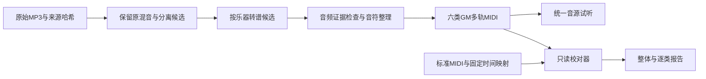

# v0.1 质量升级方案

日期：2026-10-15。状态：待用户评审的实验设计；尚未实施 v0.1，也没有新的正确率结论。

## 目标与范围

让音频转成可编辑的六类器乐 MIDI：钢琴、木吉他、电吉他、贝斯、鼓、弦乐。忽略人声，不做前端。继续以用户指定的《不将就》改编 MIDI 逐音校对，交付新 MIDI、MIDI 合成试听、逐轨结果和对照报告。

用户允许使用 API、Skill、插件等方法；可消耗现有 API 额度，新增付费前告知。当前环境未发现 KLANGIO_API_KEY、KLANG_API_KEY、REPLICATE_API_TOKEN，项目根目录也没有 .env/.env.local；这不证明用户没有服务账号。不得把其他服务的额度当作 Klangio 额度，不索要聊天明文密钥。不因缺少商业服务而阻断本地路线。

v0.1 采用质量优先的显式实验模式。拟定每个60秒候选总计最多1800秒、CPU 2线程、单候选运行，子进程内存上限6GiB；每次结果同时记录端到端耗时、分离复用与否、各阶段耗时和峰值内存。小样15秒先探测兼容性，最多600秒。正式CLI现有三倍时长和默认内存限制保持，不能把实验通过说成原性能指标通过。

## 已有证据

当前可恢复基线：提交4b40080f98a4210ac53e36bedb850f68f4811345，产物为 outputs/runs/reprocess-20261015-v2/不将就_多乐器.mid。原始输入和标准不覆盖，哈希沿用 outputs/comparison-20261015/输入校验.json。

六类标准494音、预测476音，匹配220音；精确率46.22%、召回率44.53%、F1 45.36%。该结果经过独立只读复算。它是和改编标准的一致度，不是原录音准确率。

| 类别 | 当前 F1 | 主要现象 | 首先验证的假设 |
|---|---:|---|---|
| 钢琴 | 59.68% | 标准269音，匹配148音 | 专用钢琴模型是否减少漏音；钢琴分离是否串音 |
| 木吉他 | 17.02% | 输出70音，匹配8音 | 木/电吉他分类混淆，分离输入是否更难识别 |
| 电吉他 | 0% | 标准64音，输出1音 | 当前模型是否把电吉他判为木吉他或其他乐器 |
| 贝斯 | 41.38% | 标准36音，输出51音，匹配18音 | 起音滞后、八度与切音边界是否有误 |
| 鼓 | 56.00% | 标准约7秒开始，输出约39秒才开始 | 早段鼓源是否过弱，或鼓分类/解码漏检 |
| 弦乐 | 10.26% | 标准7音，输出71音，匹配4音 | other不是纯弦乐；钢琴串音是否被当作弦乐 |

原始模型候选的进一步检查：

- guitar：265音，其中木吉他70、电吉他1、弦乐123、钢琴49、贝斯10、人声12。
- drums：398音，其中鼓56、弦乐141、钢琴126、木吉他17、贝斯19、人声39。
- other：468音，其中钢琴332、弦乐78、贝斯19、人声39。
- 来源：旧转录报告指向的 work/quality/1792048217664781000/{guitar,drums,other}.json；这里的数量在最终通用整理前，不和最终轨数混用。

这些证据提示分类、分离串音或模型对分离输入的适应性可能有问题，不能直接证明是哪一个原因。不能把所有被丢弃的候选改成目标乐器，也不能只按标准音符数量删音。

## 路线选择

| 路线 | 做法 | 优点 | 主要限制 |
|---|---|---|---|
| A：本地改进 | 原混音转谱与分离转谱对照，钢琴/鼓使用专用候选 | 无外部音频上传，不依赖付费账号，可复现 | 分类和分离质量仍有上限，CPU可能较慢 |
| B：商业 API | Klangio 小样对照，通过后才考虑完整片段 | 可快速判断本地路线是否明显落后 | 需要账号/额度，实际六类与木电区分能力必须核实 |
| C：混合路线，推荐 | 先做 A；有可用额度时加入 B；按开发集逐类选定固定路线 | 不必让一个模型负责所有乐器，同时保留可比证据 | 组合增多，需要限制实验数量，避免为一首歌过拟合 |

默认推进C的本地部分，API有可用凭据与配额后作为对照；不自动开通订阅、租GPU或购买软件。API请求会上传实际测试音频，优先只传固定15秒小样，不上传标准MIDI或整套私有素材。正式请求前核实额度和是否可能产生额外费用，不能只凭一个令牌存在就假定免费。

## 数据怎样流动

标准文件只能进入评测器，不能进入转谱和音符整理。不能把标准音符复制进预测、按标准逐音挑候选、用标准指定每个音的乐器，或直接把标准改名交付。

各模型输出统一保存乐器、音高、起音、关音、来源、原始置信证据；没有模型概率就记缺失，不伪造置信度。根据开发集确定每类固定路线和参数，随后配置锁定；不按最终测试分数逐音拼接。

## 分阶段实验

### 1. 先确定问题出在哪一层

保持输入、版本、模型、参数和音源可追溯。对原混音与六源分离音频按0–20、20–40、40–60秒检查音量、起音位置、频谱与串音；检查立体声转单声道是否相消。必要试听只生成文件，不自动占用音频设备或操作用户界面。

同一60秒输入新增一次 YourMT3 原混音对照，并排除人声输出。分别比较原始候选、类别过滤后、整理后的数量和时间位置，定位早段鼓是在分离、分类、解码还是过滤阶段消失。保留中间证据，先复现再改代码。

### 2. 做有限的候选对照

| 编号 | 改动 | 用途 |
|---|---|---|
| C0 | 原v0.0路线，排除人声，作为不变基线 | 重新评估时同条件比较 |
| C1 | YourMT3直接处理原混音，保留原模型六类标签 | 测试分离是否反而破坏分类，尤其吉他/鼓/弦乐 |
| C2 | 仅钢琴换Transkun；其他轨沿用已锁定对照 | 判断专用钢琴模型是否优于BasicPitch |
| C3 | 鼓专用模型小样，与原混音鼓、分离鼓三路比较 | 优先解决39秒前漏音，不把鼓粗类分数冒充GM细类分数 |
| C4 | 最佳本地路线，最多一组分离替换 | 仅在证据支持串音问题时测试；不同时改模型与分离器 |
| C5 | 可用额度下Klangio 15秒小样，必要时完整60秒 | 商业路线外部基准；不承诺API一定更好 |

首次最多C0–C5六类配方；每个专用模型先跑15秒兼容性小样。阈值最多在开发片段比较三组；候选与参数登记后运行，不无限搜索。没有增益就保留原路线并报告失败原因。

钢琴：Transkun是钢琴专用候选，默认checkpoint不把踏板延音直接当作按键持续；评估前统一说明关音口径。BasicPitch作为轻量基线保留。

吉他：先比较原混音与guitar分离结果的原模型乐器标签。音高检测可加BasicPitch对照，但它不区分木/电吉他，不能单凭输出MID音色编号完成分类。若现有API或模型仍不能可靠区分，两轨保留明确失败状态，不合并、猜标签或照抄标准；这会阻止六类质量验收通过。

鼓：先验证原混音YourMT3能否恢复早段鼓。ADTOF/其PyTorch移植只作为研究候选，原仓库内容采用非商业许可，不默认进入商用发行；需分别核实移植代码与权重许可。其五类输出不能自动细分所有GM鼓键，主评分仍按精确GM键，粗类分组只列辅助分数；不把不同镲片都改成同一个标准键来刷分。

弦乐：other继续被视为混合残留，不能当成纯弦乐源。使用原混音分类作为对照，结合该片段的持续谐波证据验证候选，过滤规则只基于音频。跨模型一致性可以作为候选证据，但交集可能降低召回，是否采用必须由开发集同时检查精确率与召回率，不能只追求删音后的高精确率。

贝斯：复核pYIN、起音检测、重复同音和八度跳变；保留原音频支持的切分，不强制对齐网格。若BasicPitch贝斯对照更好，开发阶段选择并锁定。

分离：现有Demucs6s保留作对照；可比较其4源htdemucs_ft的鼓/贝斯/other，或MSST中有明确配置、权重和许可的BS/Mel RoFormer。四源或人声/伴奏二源模型不能被当作木电吉他、钢琴、弦乐都能分离的模型。具体checkpoint先核实目标声源与本机资源；未找到合适权重则C4记不可运行，不临时训练模型。

### 3. 锁定评测方式

主指标沿用同类别、同音高、起音误差≤50ms的一对一最大匹配；人声完全排除。必须报告整体精确率、召回率、micro F1（所有音一起算）、macro F1（各有效类别F1平均）和逐类F1，防止钢琴音多掩盖吉他失败。

- 原60秒已经被完整评估，不能把后30秒重新命名为真正未见过的测试集。可作为开发/回归片段。
- 保留旧结果的探索性映射：标准秒=预测秒×0.9995+0.140。对同一AudioTrimmer输入，先固定该映射，所有候选共用，不为每个候选重新找最高分；重算并并列C0。
- 另做一次基于原音频和标准MIDI统一合成音频的音高/起音对齐检查；如需修正映射，先冻结新的公共映射，再统一重算C0和全部候选，旧45.36%仅作为历史数值。该音频对齐也可能有编配和音色偏差，仍需检查，不声称得到绝对真值。
- 在运行新模型前，将原长MP3的120–180秒另存为新增验收片段候选，原文件保留。先核实原长MP3、AudioTrimmer输入与标准MIDI的对应位置；不能假定三者裁切起点完全相同。
- 120–180秒仅在时间对应关系与有效器乐内容足以评测时用于验收；若不成立，标为无法建立该验收集，需要另补对照素材，不能退回开发片段冒充未见测试集。
- 新增验收片段的音符标签不用于选模型/调阈值。独立同步检查先冻结共享映射与片段哈希；随后冻结模型组合和参数，只开一次正式评估。若看到结果再改，应如实称为新的开发回合，原验收片段不再当未见测试。
- 同一首不同片段只提供曲内验证，不能证明其他歌曲也有效。5–10首真实歌曲、每类至少5首的原项目总体质量要求保留，尚未具备材料时报告未完成。

辅助指标：100/200ms容差、忽略木电区分的吉他合计、忽略旋律乐器类别、粗鼓类、带关音误差、每10秒错漏音分布。它们不能替代主指标。标准无某类且预测也无时记N/A；只有预测时记多余音并纳入整体分母，不把0音当100%正确。

声音验收：同一采样音色库、近似等响度分别试听单轨和合奏；不混原曲，不做掩盖错音的自动伴奏。安排逐轨20秒对照和两段合奏试听，记录可辨认程度、错乐器、节奏缺口及用户实际修正分钟数。没有实际听辨结果就标为未验证。

## v0.1 目标和版本规则

以下是待本方案评审确认的实验目标，不是效果保证，也不降低原正式质量门槛：

- 开发片段：统一公共映射下，整体F1至少比同条件C0增加10个百分点，且达到60%；macro F1至少45%，每个有标准音符的类别至少35%，逐类精确率/召回率必须同时公开。
- 新增验收片段：整体F1至少60%、macro F1至少45%，每个有标准音符的类别至少35%，相对该片段同条件C0没有类别F1下降超过5个百分点。某类标准不足10音时，不作稳定分类能力推断；报告原始计数，并说明需补样本。
- 第一目标仍是争取整体及逐类70%；没有证据不能承诺这次一定做到。正式产品质量仍以原多曲集与逐类70%提议口径、用户最终确认和听辨验收为准。
- MIDI结构、鼓通道、音色设置、重音与时序、无非法音符、无同音重叠、可打开编辑等工程检查必须通过；本机未操作Logic就不写实机通过。
- 规划文档只使用v0.1.0-planning标签，不更改程序版本号冒充实现完成。
- 实验实现并评估后发布v0.1.0-rc.N，明确实验通过/未通过/样本不足；正式v0.1.0待既定质量要求和用户验收。即使候选全部不及基线，也交付对照证据与最佳结果，明确未达到升级质量目标，不通过改标签掩盖失败。

## 交付、验证与可恢复性

后续执行方式沿用用户指定：主agent负责实现，完成可检查版本后先提交冻结；再启动只读独立验证子agent，不默认采信主agent总结。验证计分、数据泄漏、乐器分类、时间线、漏项与边界，给出位置和证据。确认问题由主agent修复并冻结新版本，再验证受影响部分。

预期交付目录 outputs/v0.1/runs/<run-id>/：六类多轨.mid、统一音色试听.wav、每轨可选独奏.mid/.wav、逐音报告.json、v0.0-v0.1对比.md、独立验证.md。音频/MIDI/逐音大结果保持本地，代码、配置、摘要和文档提交私有GitHub，记录来源、许可证、模型/权重哈希、运行参数、机器资源和花费。

API错误需区分未配置、无额度、鉴权失败、429限流、服务超时、返回文件坏损、只有量化MIDI或缺失轨道。默认只取非量化MIDI用于时序评分；无该格式则另列受限结果，不当作本地等价对照。记录job ID和状态，未知是否创建成功时不盲目重复提交造成多次扣费；API失败不静默补零或改用别的结果冒充成功。

本地模型必须固定版本/权重哈希，使用隔离环境，保留v0.0环境与产物。遇到内存/超时先停止该候选，记录失败并降为15秒小样；不无限重试。输出新目录，不覆盖历史文件。

本设计当前可查文件：src/audio_midi/backends/selected.py（模型与解码）、stems.py（分离轨类别筛选）、contour.py（单音高估计）、evaluate.py（匹配）、midi.py与render.py（导出与试听）、scripts/reprocess_split.py（现流程）。后续详细工程实施计划在此设计评审通过后编写，不在本轮提前安装依赖或修改转谱代码。

## 工具核实与来源

以下仅代表2026-10-15核实的公开能力，不代表本曲实测成绩：

- [Transkun官方仓库](https://github.com/Yujia-Yan/Transkun)：钢琴专用Audio-to-MIDI，CPU接口、分段推理、踏板口径明确，MIT代码许可；具体所用checkpoint及权重许可另记录。
- [BasicPitch官方仓库](https://github.com/spotify/basic-pitch)：通用音高转谱，官方说明单乐器输入效果最好；不能据此声称可分类木/电吉他。
- [Demucs官方仓库](https://github.com/facebookresearch/demucs)：6源钢琴已知串音和伪影；htdemucs_ft是4源候选，非6类器乐分离保证。
- [ADTOF原始仓库](https://github.com/MZehren/ADTOF)：自动鼓转谱；仓库内容为CC BY-NC-SA 4.0，研究对照与商业上线分开。
- [ADTOF PyTorch移植](https://github.com/xavriley/ADTOF-pytorch)：提供推理与随包权重候选，原模型五类输出；许可与细鼓映射须另核实，不能只看可安装就当作商用可用。
- [MSST官方仓库](https://github.com/ZFTurbo/Music-Source-Separation-Training)：可加载BS/Mel RoFormer等架构及配置，不保证任意权重都分离本项目六类。
- [Klangio API文档](https://api-docs.klang.io/)与[请求/下载流程](https://api-docs.klang.io/docs/getting-started/basic-job-workflow)：可输出非量化midi和midi_quant；公开首页列钢琴、吉他、贝斯、人声，不能凭其多乐器网页宣传推断API当前额度覆盖鼓/弦乐/木电细分。具体端点模型与输出需拿到账号后确认。
- [Klangio API定价](https://klang.io/api/)：公开Basic为$0/月、50请求、单次最多15秒、每分钟1请求；Startup为$99/月、500请求、单次最多300秒。最终以账户和实际计费为准，本轮未订阅或发起音频请求。
- 插件目录搜索“music transcription MIDI Klangio”只返回会议语音类工具，没有发现可直接完成音乐分轨MIDI的连接器；搜索结果并非完整目录。当前无需安装无关插件，可使用本地模型或直接API。
- Skill可约束复现、调试、评估和验证流程；不能代替音高模型，不把添加Skill当作准确率已提升。
